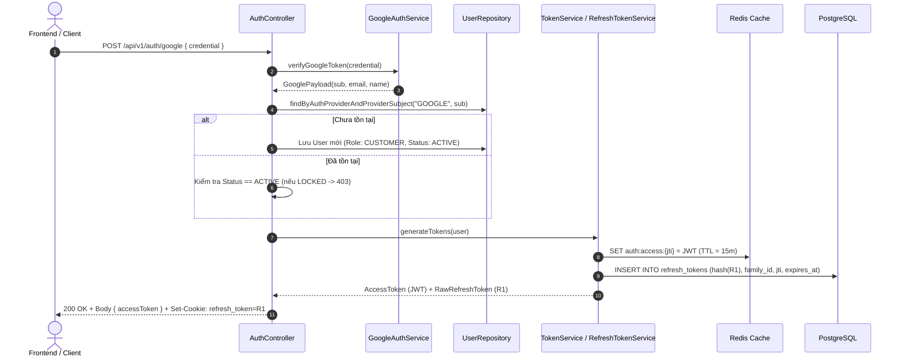
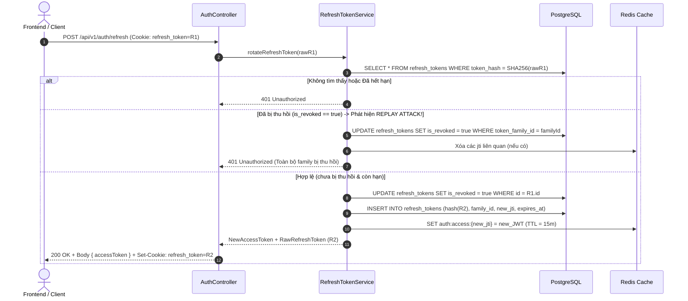
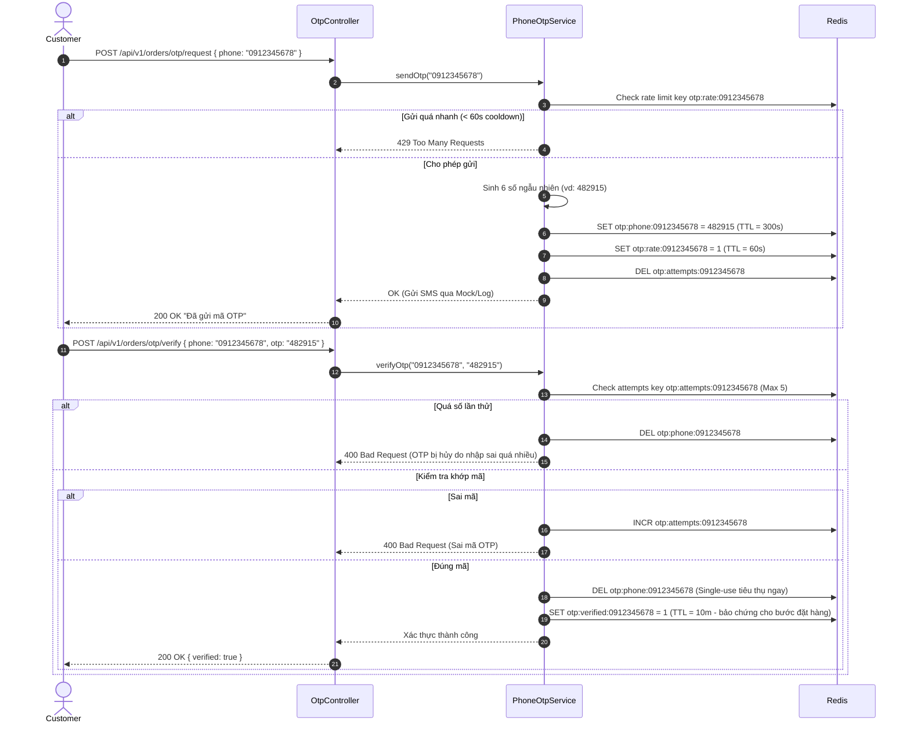

# Kế hoạch chi tiết triển khai Phase 2: Authentication, Tokens & OTP

> **Tài liệu tham chiếu**: [AGENTS.md](file:///d:/HMP/sales-backend/AGENTS.md) | [architecture.md](file:///d:/HMP/sales-backend/architecture.md) | [database.md](file:///d:/HMP/sales-backend/database.md) | [api-spec.md](file:///d:/HMP/sales-backend/api-spec.md) | [.agents/rules/project-rules.md](file:///d:/HMP/sales-backend/.agents/rules/project-rules.md)

---

## 1. Mục tiêu và Phạm vi (Scope & Objectives)

Phase 2 thiết lập toàn bộ cơ chế bảo mật xác thực người dùng, cấp phát và thu hồi token, cùng luồng xác minh số điện thoại qua OTP:

1. **Google OAuth Token Verification & User Mapping**: Xác thực Google ID Token, tự động đồng bộ/tạo tài khoản `CUSTOMER` (idempotent), hỗ trợ đăng nhập cho `MANAGER` (đã được Admin provision trước).
2. **Application JWT Minting & Redis Token Registry**: Cấp phát Access Token (JWT) chỉ chứa `sub` (userId), `email`, `roles` (`["ROLE_CUSTOMER"]`, `["ROLE_ADMIN"]`), `jti`, `exp` (TUYỆT ĐỐI KHÔNG lưu `permissions` trong token nhằm tối ưu kích thước token và tránh stale permissions). Đăng ký `auth:access:{jti}` vào Redis với TTL. Mọi phân quyền chi tiết được xử lý động qua `PermissionAuthorizationManager` tại FilterChain.
3. **Refresh Token & Rotation (PostgreSQL)**: Lưu trữ mã băm SHA-256 của Refresh Token trong bảng `refresh_tokens`, hỗ trợ Token Family, xoay vòng token (rotation) nguyên tử và phát hiện tấn công tái sử dụng (replay attack detection).
4. **HttpOnly Cookie Transport**: Trả Refresh Token qua cookie `HttpOnly; Secure; SameSite=Lax; Path=/api/v1/auth`, đồng thời hỗ trợ Access Token trong JSON response.
5. **Logout Flow**: Thu hồi cả `jti` trên Redis và đánh dấu thu hồi Refresh Token trên PostgreSQL, xóa cookie.
6. **Phone OTP Service (Redis)**: Sinh OTP 6 chữ số ngẫu nhiên, quản lý TTL (5 phút), giới hạn tần suất gửi (rate limiting/cooldown) và số lần thử nhập sai (max attempts), hủy mã ngay sau khi xác thực thành công (single-use).

---

## 2. Kiến trúc & Luồng dữ liệu (Architecture & Workflows)

### 2.1 Luồng Đăng nhập Google & Cấp phát Token


### 2.2 Luồng Refresh Token Rotation & Phát hiện Replay


### 2.3 Luồng Phone OTP (Redis)


---

## 3. Thiết kế Cơ sở Dữ liệu & Redis

### 3.1 Entity `RefreshToken` (PostgreSQL Table: `refresh_tokens`)
Tuân thủ Mục 17 của `database.md`:

| Tên cột | Kiểu dữ liệu | Nullable | Ràng buộc / Ý nghĩa |
|---|---|:---:|---|
| `refresh_token_id` | `BIGINT` | No | PK, `IDENTITY` / `BIGSERIAL` |
| `user_id` | `BIGINT` | No | FK liên kết `users(user_id)` |
| `token_family_id` | `UUID` | No | Định danh chuỗi xoay vòng token |
| `token_hash` | `BYTEA` hoặc `VARCHAR(64)` | No | SHA-256 hash của plain token (hex 64 chars hoặc 32 bytes) |
| `access_token_jti` | `UUID` | No | JTI của access token được cấp cùng |
| `expires_at` | `TIMESTAMP WITH TIME ZONE` | No | Thời điểm hết hạn |
| `is_revoked` | `BOOLEAN` | No | `false` khi active, `true` khi đã xoay hoặc bị hủy |
| `created_at` | `TIMESTAMP WITH TIME ZONE` | No | Thời điểm tạo |
| `is_deleted` | `BOOLEAN` | No | Cờ xóa mềm (mặc định `false`) |

**Indexes**:
- Index duy nhất hoặc tra cứu nhanh: `CREATE INDEX idx_refresh_tokens_hash ON refresh_tokens(token_hash);`
- Index theo family: `CREATE INDEX idx_refresh_tokens_family ON refresh_tokens(token_family_id);`

### 3.2 Redis Key Schema

| Key Pattern | Kiểu | TTL | Mục đích |
|---|---|---|---|
| `auth:access:{jti}` | String (`JWT`) | 15 phút (theo `app.jwt.expiration-minutes`) | Đăng ký access token đang hoạt động, được kiểm tra bởi `RedisTokenValidationFilter` |
| `otp:phone:{phone}` | String (6 số) | 300 giây (5 phút) | Lưu trữ mã OTP tạm thời |
| `otp:rate:{phone}` | String (`1`) | 60 giây | Cooldown chống spam gửi OTP liên tục |
| `otp:attempts:{phone}` | String (số nguyên) | 300 giây | Đếm số lần nhập sai (tối đa 5 lần) |
| `otp:verified:{phone}` | String (`1`) | 600 giây (10 phút) | Đánh dấu số điện thoại đã được xác thực thành công để bảo chứng bước tạo đơn hàng |

---

## 4. Cấu trúc Gói (Package Structure) & Danh sách File

Tuân thủ cấu trúc package `com.hmp.sales.feature.auth` và `com.hmp.sales.feature.otp`:

```text
src/main/java/com/hmp/sales/
├── feature
│   ├── auth
│   │   ├── controller
│   │   │   └── AuthController.java                  # Endpoints: /google, /refresh, /logout
│   │   ├── dto
│   │   │   ├── GoogleLoginRequest.java              # Request record { credential }
│   │   │   ├── AuthResponse.java                    # Response record { accessToken, tokenType }
│   │   │   └── RefreshTokenRequest.java             # Optional body fallback { refreshToken }
│   │   ├── entity
│   │   │   └── RefreshToken.java                    # JPA Entity refresh_tokens
│   │   ├── repository
│   │   │   └── RefreshTokenRepository.java          # Spring Data JPA
│   │   ├── service
│   │   │   ├── AuthService.java                     # Interface đăng nhập, refresh, logout
│   │   │   ├── AuthServiceImpl.java                 # Implementation
│   │   │   ├── GoogleAuthService.java               # Interface xác thực Google ID token
│   │   │   ├── GoogleAuthServiceImpl.java           # RestClient / Google TokenInfo verifier
│   │   │   ├── JwtTokenService.java                 # Interface sinh JWT, giải mã, quản lý Redis JTI
│   │   │   ├── JwtTokenServiceImpl.java             # Implementation dùng Nimbus JOSE / HMAC SHA-256
│   │   │   ├── RefreshTokenService.java             # Interface quản lý vòng đời refresh token & family
│   │   │   └── RefreshTokenServiceImpl.java         # Implementation
│   │   └── util
│   │       ├── HashUtils.java                       # SHA-256 hashing helper
│   │       └── CookieUtils.java                     # Tạo/Xóa HttpOnly secure cookie
│   └── otp
│       ├── controller
│       │   └── OtpController.java                   # Endpoints: /orders/otp/request, /orders/otp/verify
│       ├── dto
│       │   ├── OtpRequest.java                      # Request record { phone }
│       │   ├── OtpVerifyRequest.java                # Request record { phone, otp }
│       │   └── OtpVerifyResponse.java               # Response record { verified, message }
│       └── service
│           ├── PhoneOtpService.java                 # Interface tạo, gửi, verify OTP
│           └── PhoneOtpServiceImpl.java             # Implementation với RedisTemplate
```

---

## 5. Danh mục API Contracts (Chi tiết theo `api-spec.md`)

### 5.1 `POST /api/v1/auth/google`
- **Request Body**:
  ```json
  {
    "credential": "eyJhbGciOiJSUzI1NiIs..."
  }
  ```
- **Response Header**:
  ```http
  Set-Cookie: refresh_token=<opaque-token>; HttpOnly; Secure; SameSite=Lax; Path=/api/v1/auth; Max-Age=604800
  ```
- **Response Body (200 OK)**:
  ```json
  {
    "statusCode": 200,
    "data": {
      "accessToken": "eyJhbGciOiJIUzI1NiIs...",
      "tokenType": "Bearer"
    },
    "message": "Đăng nhập Google thành công",
    "timestamp": "2026-10-21T00:00:00"
  }
  ```

### 5.2 `POST /api/v1/auth/refresh`
- **Request**: Đọc token từ Cookie `refresh_token` (hoặc body `refreshToken` nếu cookie không có).
- **Response Header**: Set-Cookie với `refresh_token` mới xoay vòng.
- **Response Body (200 OK)**:
  ```json
  {
    "statusCode": 200,
    "data": {
      "accessToken": "eyJhbGciOiJIUzI1NiIs...(new)",
      "tokenType": "Bearer"
    },
    "message": "Làm mới token thành công",
    "timestamp": "2026-10-21T00:00:00"
  }
  ```

### 5.3 `POST /api/v1/auth/logout`
- **Request**: Header `Authorization: Bearer <accessToken>` + Cookie `refresh_token`.
- **Hành vi**:
  - Lấy `jti` từ Access Token -> Xóa `auth:access:{jti}` trong Redis.
  - Lấy Refresh Token -> Đánh dấu `is_revoked = true` trong PostgreSQL.
  - Xóa cookie bằng header: `Set-Cookie: refresh_token=; Max-Age=0; Path=/api/v1/auth`.
- **Response Body (200 OK)**:
  ```json
  {
    "statusCode": 200,
    "data": null,
    "message": "Đăng xuất thành công",
    "timestamp": "2026-10-21T00:00:00"
  }
  ```

### 5.4 `POST /api/v1/orders/otp/request`
- **Request Body**:
  ```json
  {
    "phone": "0987654321"
  }
  ```
- **Response Body (200 OK)**:
  ```json
  {
    "statusCode": 200,
    "data": null,
    "message": "Mã xác thực OTP đã được gửi thành công",
    "timestamp": "2026-10-21T00:00:00"
  }
  ```

### 5.5 `POST /api/v1/orders/otp/verify`
- **Request Body**:
  ```json
  {
    "phone": "0987654321",
    "otp": "123456"
  }
  ```
- **Response Body (200 OK)**:
  ```json
  {
    "statusCode": 200,
    "data": {
      "verified": true,
      "phone": "0987654321"
    },
    "message": "Xác thực số điện thoại thành công",
    "timestamp": "2026-10-21T00:00:00"
  }
  ```

---

## 6. Kế hoạch Kiểm thử (Testing Matrix)

Mỗi thành phần sẽ có bộ test JUnit 5 độc lập bao phủ các trường hợp biên:

### 6.1 Unit Tests (`src/test/java/com/hmp/sales/feature/auth/...`)
1. **`JwtTokenServiceImplTest`**:
   - Sinh JWT đúng claims tối giản: `sub` (userId), `email`, `roles` (`["ROLE_CUSTOMER"]` hoặc `["ROLE_ADMIN"]`), `jti`, `exp`.
   - **Xác minh KHÔNG chứa claim `permissions`** trong payload của JWT (tuân thủ quy chuẩn thiết kế phân quyền động tại FilterChain).
   - Đăng ký đúng key `auth:access:{jti}` vào Redis với TTL.
   - Thu hồi token xóa đúng key trên Redis.
2. **`RefreshTokenServiceImplTest`**:
   - Tạo mới refresh token lưu hash SHA-256 vào DB.
   - Xoay vòng (rotate) thành công: revoke token cũ, cấp token mới cùng `token_family_id`.
   - **Phát hiện Replay Attack**: Đưa vào token đã revoked -> toàn bộ `token_family_id` bị thu hồi, ném `UnauthorizedOperationException`.
   - Token hết hạn (`expires_at < now`) -> từ chối.
3. **`GoogleAuthServiceImplTest`**:
   - Verify token hợp lệ -> trả về payload email, subject, name.
   - Token giả mạo hoặc lỗi từ Google API -> ném `UnauthorizedOperationException`.
4. **`AuthServiceImplTest`**:
   - Đăng nhập Google tài khoản mới -> tạo User role `CUSTOMER` (idempotent).
   - Đăng nhập Google tài khoản bị khóa (`LOCKED`) -> từ chối (403).
5. **`PhoneOtpServiceImplTest`**:
   - Sinh 6 chữ số, lưu Redis TTL 300s.
   - Thử gửi lại khi chưa hết 60s cooldown -> ném `BusinessRuleException` (Rate limit).
   - Nhập sai mã -> tăng counter attempts.
   - Nhập sai quá 5 lần -> tự động xóa OTP, khóa yêu cầu.
   - Nhập đúng mã -> xóa OTP khỏi Redis, đánh dấu verified.

### 6.2 Integration Tests
1. **`AuthControllerIntegrationTest`**:
   - Giả lập gọi `POST /api/v1/auth/google`, kiểm tra Set-Cookie và JSON body.
   - Kiểm tra `POST /api/v1/auth/refresh` với Cookie header.
   - Kiểm tra `POST /api/v1/auth/logout` xóa token trên Redis và vô hiệu hóa Cookie.
2. **`OtpControllerIntegrationTest`**:
   - Test flow request OTP -> verify OTP qua MockMvc.

---

## 7. Các bước triển khai tuần tự (Step-by-Step Execution Plan)

### 📌 Bước 1: Hạ tầng Token & CSDL (Foundation & Persistence)
1. Tạo Entity `RefreshToken` & `RefreshTokenRepository`.
2. Tạo tiện ích `HashUtils` (SHA-256) và `CookieUtils`.
3. Triển khai `JwtTokenService` & `JwtTokenServiceImpl` (cấp phát JWT với claims chuẩn: `sub`, `email`, `roles`, `jti`, `exp` — tuyệt đối không nhúng `permissions`; tích hợp `StringRedisTemplate` lưu `auth:access:{jti}`).
4. Triển khai `RefreshTokenService` & `RefreshTokenServiceImpl` (logic rotation + family reuse detection).
5. Viết Unit tests cho `JwtTokenService` và `RefreshTokenService`.

### 📌 Bước 2: Dịch vụ Google Auth & Xác thực Người dùng
1. Triển khai `GoogleAuthService` & `GoogleAuthServiceImpl` sử dụng Spring Boot `RestClient` gọi Google TokenInfo API (an toàn, nhẹ, không cần thêm thư viện bên ngoài).
2. Tạo DTOs: `GoogleLoginRequest`, `AuthResponse`, `RefreshTokenRequest`.
3. Triển khai `AuthService` & `AuthServiceImpl` (kết nối GoogleAuth + User lookup/create + Token minting).
4. Viết Unit test cho `AuthService`.

### 📌 Bước 3: Endpoints Xác thực & Kiểm thử tích hợp Auth
1. Tạo `AuthController` với các endpoints `/api/v1/auth/google`, `/refresh`, `/logout`.
2. Đảm bảo cấu hình `SecurityConfig` cho phép WHITELIST truy cập các endpoints auth.
3. Viết `AuthControllerIntegrationTest`.

### 📌 Bước 4: Dịch vụ Phone OTP bằng Redis
1. Tạo DTOs cho OTP: `OtpRequest`, `OtpVerifyRequest`, `OtpVerifyResponse`.
2. Triển khai `PhoneOtpService` & `PhoneOtpServiceImpl` sử dụng Redis cho TTL, rate-limiting, attempt-tracking.
3. Tạo `OtpController` với các endpoints `/api/v1/orders/otp/request` và `/verify`.
4. Viết Unit test và Integration test cho luồng OTP.

### 📌 Bước 5: Cập nhật tài liệu & Trạng thái dự án
1. Cập nhật `project-status.md` (chuyển các mục Phase 2 sang hoàn thành).
2. Kiểm tra toàn bộ test suite dự án đảm bảo 100% tests pass.
