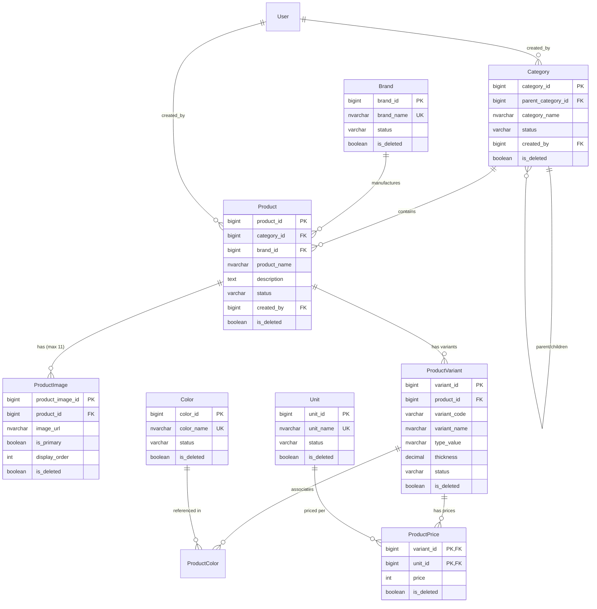

# Kế hoạch chi tiết triển khai Phase 3: Catalog & Category Hierarchy

> **Tài liệu tham chiếu**: [AGENTS.md](file:///d:/HMP/sales-backend/AGENTS.md) | [architecture.md](file:///d:/HMP/sales-backend/architecture.md) | [database.md](file:///d:/HMP/sales-backend/database.md) | [api-spec.md](file:///d:/HMP/sales-backend/api-spec.md) | [.agents/rules/project-rules.md](file:///d:/HMP/sales-backend/.agents/rules/project-rules.md)

---

## 1. Mục tiêu và Phạm vi (Scope & Objectives)

Phase 3 thiết lập toàn bộ danh mục sản phẩm (Catalog), cấu trúc cây danh mục tự tham chiếu (Category Tree), danh mục cấu hình động (Master Data: Brand, Unit, Color) do Admin quản trị, và mô hình sản phẩm tôn cuộn/tôn lợp mái phục vụ quy trình sản xuất và đặt hàng:

1. **Category Tree Hierarchy (Cây thư mục danh mục)**:
   - Hỗ trợ quan hệ cha - con tự tham chiếu (`parentCategoryId`), danh mục gốc có `parentCategoryId = null`.
   - Thuật toán chống lặp vòng quan hệ (Cycle Detection / Circular Reference Prevention) khi tạo mới hoặc cập nhật danh mục cha.
   - Thao tác theo mô hình file-system: Tại một danh mục hiện tại, Quản lý (Manager) có thể chọn tạo danh mục con hoặc tạo sản phẩm trực tiếp dưới danh mục đó.
2. **Master Data Danh mục cấu hình động do Admin quản trị (Dynamic Catalog Configuration)**:
   - **`Brand` (Thương hiệu/Nhà sản xuất)**: Hoa Sen, Đông Á, Nam Kim,... Admin quản trị CRUD đầy đủ, tìm kiếm/phân trang, khóa/mở khóa. Chặn xóa nếu đã có sản phẩm liên kết.
   - **`Unit` (Đơn vị tính bán hàng)**: `m`, `tấm`, `cuộn`, `cái`,... Admin quản trị CRUD đầy đủ, tìm kiếm/phân trang, khóa/mở khóa. Chặn xóa nếu đã có bảng giá liên kết.
   - **`Color` (Màu sắc tôn sản xuất)**: Xanh ngọc, Đỏ đậm, Xanh rêu, Xám lông chuột, Trắng sữa,... Admin quản trị CRUD đầy đủ, tìm kiếm/phân trang, khóa/mở khóa. Chặn xóa nếu đã có biến thể sản phẩm liên kết.
   - Cung cấp các endpoint Public GET phục vụ dropdown chọn thương hiệu, đơn vị tính, màu sắc khi lọc hoặc tạo sản phẩm/đơn hàng.
3. **Mô hình Sản phẩm & Biến thể Sản xuất (Product & Variants)**:
   - `Product`: Thuộc tính định danh, mô tả, liên kết Brand, Category, trạng thái (`ACTIVE`, `INACTIVE` / `LOCKED`).
   - `ProductImage`: 1 ảnh đại diện (`isPrimary = true`), tối đa 10 ảnh phụ (tổng tối đa 11 ảnh cho 1 sản phẩm).
   - `ProductVariant`: Thông số kỹ thuật sản xuất (loại sóng `typeValue`, độ dày `thickness`), liên kết màu sắc (`ProductColor`).
   - *Lưu ý nghiệp vụ cốt lõi*: Chiều dài/kích thước cắt tôn do khách hàng yêu cầu khi đặt hàng KHÔNG lưu tĩnh trong ProductVariant mà thuộc về snapshot của `OrderItem`.
   - `ProductPrice`: Ánh xạ giá bán linh hoạt theo đơn vị tính (`(variantId, unitId) -> price`), tính theo số nguyên VND (`INT`/`BIGINT`).
4. **Bảo mật & Phân quyền hiển thị giá (Price Visibility)**:
   - Giá sản phẩm được bảo vệ bằng quyền động `PRODUCT_PRICE_VIEW`.
   - Khách vãng lai và khách hàng (CUSTOMER) mặc định chưa có quyền này sẽ nhận `prices = null` và `priceVisible = false`.
   - Tuyệt đối không cho phép sắp xếp theo giá (`sortBy=price`) nếu caller không có quyền xem giá (tránh rò rỉ thông tin giá gián tiếp qua thứ tự sắp xếp).
5. **Ràng buộc toàn vẹn & Cơ chế Xóa mềm (Soft Delete)**:
   - **Xóa mềm Category (có cảnh báo Confirm)**:
     - Nếu danh mục rỗng (không có con/sản phẩm) -> Cho phép xóa mềm (`isDeleted = true`) ngay lập tức.
     - Nếu danh mục còn chứa danh mục con hoặc sản phẩm:
       - Khi gọi `DELETE /api/v1/manager/categories/{id}` (không có `force=true`): Hệ thống trả về `409 Conflict` kèm dữ liệu số lượng (`childCategoryCount`, `productCount`, `totalImpactCount`) để Frontend hiển thị Popup Confirm cảnh báo: *"Trong danh mục này chứa X danh mục và sản phẩm khác, bạn có chắc chắn muốn xóa danh mục này không?"*.
       - Khi người dùng xác nhận trên Popup và Client gửi `DELETE ...?force=true`: Hệ thống kiểm tra nếu không có sản phẩm nào trong cây con đang nằm trong đơn hàng chưa hoàn thành thì sẽ tiến hành xóa mềm cascade (đánh dấu `isDeleted = true` toàn bộ cây con).
   - **Xóa mềm Product (chỉ chặn khi có đơn dở dang)**:
     - Hoàn toàn cho phép xóa mềm sản phẩm (`isDeleted = true`) ngay cả khi sản phẩm đã từng phát sinh trong đơn hàng lịch sử đã hoàn thành (`COMPLETED`) hoặc đã hủy (`CANCELLED`), vì đơn hàng lịch sử lưu snapshot bất biến.
     - **CHỈ CHẶN XÓA (409 Conflict)** khi sản phẩm đó đang nằm trong một đơn hàng **chưa hoàn thành** (trạng thái `PENDING`, `CONFIRMED`, `PROCESSING`, `SHIPPING`).

---

## 2. Kiến trúc & Thiết kế Thực thể (Database & Entity Model)

### 2.1 Sơ đồ quan hệ thực thể (ERD)



---

## 3. Cấu trúc Package và Lớp kỹ thuật (Package Structure)

Tuân thủ nghiêm ngặt quy tắc tại [.agents/rules/project-rules.md](file:///d:/HMP/sales-backend/.agents/rules/project-rules.md) (mẫu `Interface + Impl`, DTO tại ranh giới API, Javadoc tiếng Việt đầy đủ):

```text
com.hmp.sales.feature
├── category
│   ├── controller
│   │   ├── PublicCategoryController.java    // GET /api/v1/categories/tree, GET /api/v1/categories/{id}/products
│   │   └── ManagerCategoryController.java   // POST/PATCH/DELETE /api/v1/manager/categories/**
│   ├── dto
│   │   ├── CategoryTreeResponse.java        // Dạng cây phân cấp n-cấp
│   │   ├── CategoryResponse.java            // Thông tin cơ bản 1 danh mục
│   │   ├── CategoryCreateRequest.java       // Payload tạo danh mục (root hoặc con)
│   │   ├── CategoryUpdateRequest.java       // Payload đổi tên/trạng thái
│   │   └── CategoryProductsResponse.java    // Danh sách sản phẩm thuộc danh mục
│   ├── entity
│   │   ├── Category.java                    // Entity categories
│   │   └── CategoryStatus.java              // Enum ACTIVE, LOCKED
│   ├── repository
│   │   └── CategoryRepository.java          // Truy vấn cây, tìm theo parent, kiểm tra trùng tên
│   └── service
│       ├── CategoryService.java             // Interface nghiệp vụ cây danh mục
│       └── impl
│           └── CategoryServiceImpl.java     // Logic cycle check, dựng cây, CRUD
│
└── product
    ├── controller
    │   ├── PublicProductController.java     // GET /api/v1/products, GET /api/v1/products/{id}
    │   ├── PublicMasterDataController.java  // GET /api/v1/brands, GET /api/v1/units, GET /api/v1/colors
    │   ├── ManagerProductController.java    // POST/PATCH/DELETE /api/v1/manager/products/**, images, variants
    │   ├── AdminBrandController.java        // CRUD /api/v1/admin/brands/**
    │   ├── AdminUnitController.java         // CRUD /api/v1/admin/units/**
    │   └── AdminColorController.java        // CRUD /api/v1/admin/colors/**
    ├── dto
    │   ├── BrandRequest.java                // Payload tạo/sửa Brand
    │   ├── BrandResponse.java               // DTO Brand
    │   ├── UnitRequest.java                 // Payload tạo/sửa Unit
    │   ├── UnitResponse.java                // DTO Unit
    │   ├── ColorRequest.java                // Payload tạo/sửa Color
    │   ├── ColorResponse.java               // DTO Color
    │   ├── ProductSummaryResponse.java      // Danh sách gọn khi search/filter
    │   ├── ProductDetailResponse.java       // Chi tiết sản phẩm kèm variants, images, prices
    │   ├── ProductVariantResponse.java      // Chi tiết biến thể + giá theo unit
    │   ├── ProductImageResponse.java        // Chi tiết ảnh
    │   ├── ProductCreateRequest.java        // Payload tạo sản phẩm theo thư mục
    │   ├── ProductUpdateRequest.java        // Payload cập nhật sản phẩm
    │   ├── ProductVariantRequest.java       // Payload tạo/sửa biến thể
    │   ├── ProductImageUploadRequest.java   // Payload ảnh (hoặc URL cloud)
    │   └── ProductFilterParams.java         // Filter, pagination & sort
    ├── entity
    │   ├── Brand.java                       // Entity brands
    │   ├── BrandStatus.java                 // Enum ACTIVE, LOCKED
    │   ├── Unit.java                        // Entity units
    │   ├── UnitStatus.java                  // Enum ACTIVE, LOCKED
    │   ├── Color.java                       // Entity colors
    │   ├── ColorStatus.java                 // Enum ACTIVE, LOCKED
    │   ├── Product.java                     // Entity products
    │   ├── ProductImage.java                // Entity product_images
    │   ├── ProductVariant.java              // Entity product_variants
    │   ├── ProductColor.java                // Entity product_colors
    │   ├── ProductColorId.java              // Composite PK
    │   ├── ProductPrice.java                // Entity product_prices
    │   ├── ProductPriceId.java              // Composite PK
    │   ├── ProductStatus.java               // Enum ACTIVE, LOCKED
    │   └── VariantStatus.java               // Enum ACTIVE, LOCKED
    ├── repository
    │   ├── BrandRepository.java
    │   ├── UnitRepository.java
    │   ├── ColorRepository.java
    │   ├── ProductRepository.java
    │   ├── ProductImageRepository.java
    │   ├── ProductVariantRepository.java
    │   ├── ProductColorRepository.java
    │   └── ProductPriceRepository.java
    └── service
        ├── BrandService.java                // Interface CRUD Brand cho Admin + Public Active List
        ├── impl
        │   └── BrandServiceImpl.java
        ├── UnitService.java                 // Interface CRUD Unit cho Admin + Public Active List
        ├── impl
        │   └── UnitServiceImpl.java
        ├── ColorService.java                // Interface CRUD Color cho Admin + Public Active List
        ├── impl
        │   └── ColorServiceImpl.java
        ├── ProductService.java              // Interface nghiệp vụ sản phẩm
        └── impl
            └── ProductServiceImpl.java      // Logic lọc giá dynamic, upload ảnh, quản lý variant
```

---

## 4. Các bước triển khai chi tiết (Step-by-Step Tasks)

### Task 1: Khởi tạo Master Data Entities & Repositories (`Category`, `Brand`, `Unit`, `Color`) [x]
- **Mục tiêu**: Thiết lập các bảng danh mục cơ sở, trạng thái hoạt động và ràng buộc khóa duy nhất.
- **Thực hiện**:
  1. Tạo các Enums: `CategoryStatus`, `BrandStatus`, `UnitStatus`, `ColorStatus` (`ACTIVE`, `LOCKED`).
  2. Tạo `Category` entity (`category_id`, `parent_category_id`, `category_name`, `status`, `created_by`, audit timestamps, `is_deleted`).
  3. Tạo `Brand` entity (`brand_id`, `brand_name` unique, `status`, audit timestamps, `is_deleted`).
  4. Tạo `Unit` entity (`unit_id`, `unit_name` unique, `status`, audit timestamps, `is_deleted`).
  5. Tạo `Color` entity (`color_id`, `color_name` unique, `status`, audit timestamps, `is_deleted`).
  6. Tạo các Spring Data JPA repositories:
     - `CategoryRepository`: `findAllByIsDeletedFalse()`, `findByParentCategoryIdAndIsDeletedFalse()`, `existsByCategoryNameAndParentCategoryIdAndIsDeletedFalse()`.
     - `BrandRepository`: `findByNameAndIsDeletedFalse()`, `existsByBrandNameAndIsDeletedFalse()`, tìm kiếm phân trang có lọc `status`.
     - `UnitRepository`: `findByNameAndIsDeletedFalse()`, `existsByUnitNameAndIsDeletedFalse()`, tìm kiếm phân trang có lọc `status`.
     - `ColorRepository`: `findByNameAndIsDeletedFalse()`, `existsByColorNameAndIsDeletedFalse()`, tìm kiếm phân trang có lọc `status`.
  7. Viết Unit & Repository Tests xác thực lưu trữ, soft-delete và unique constraints.

### Task 2: Dịch vụ Quản lý Cây Danh mục (`CategoryService` & Cycle Detection) [x]
- **Mục tiêu**: Xây dựng thuật toán dựng cây danh mục n-cấp và kiểm tra phát hiện vòng lặp cha-con (Circular Reference).
- **Thực hiện**:
  1. `CategoryService` & `CategoryServiceImpl`:
     - `getCategoryTree()`: Lấy toàn bộ danh mục hoạt động, chuyển đổi thành cây phân cấp `CategoryTreeResponse` (dùng Map in-memory để đạt hiệu năng $O(N)$, không đệ quy truy vấn N+1 vào DB).
     - `getProductsByCategory(Long categoryId)`: Lấy thông tin danh mục và danh sách sản phẩm `ACTIVE` trực thuộc.
     - `createRootCategory(CategoryCreateRequest req, Long managerId)`: Tạo danh mục cấp cao nhất (`parentCategoryId = null`).
     - `createChildCategory(Long parentId, CategoryCreateRequest req, Long managerId)`: Xác thực parent tồn tại, tạo danh mục con.
     - `updateCategory(Long categoryId, CategoryUpdateRequest req)`: Đổi tên, đổi parent (nếu có) kèm thuật toán phát hiện chu trình (nếu parent mới là con cháu của chính category hiện tại -> ném lỗi `BusinessRuleException`).
     - `deleteCategory(Long categoryId, boolean force)`:
       - Nếu danh mục rỗng: Xóa mềm thành công (`isDeleted = true`).
       - Nếu còn con/sản phẩm:
         - Khi `force = false`: Trả về lỗi 409 Conflict kèm payload số lượng con/sản phẩm để frontend hiện popup confirm.
         - Khi `force = true`: Kiểm tra nếu có sản phẩm nào trong cây con đang nằm trong đơn hàng chưa hoàn thành thì ném lỗi 409 Conflict; ngược lại thực hiện cascade soft-delete toàn bộ cây con.
  2. Viết Unit Tests cho cây danh mục:
     - Dựng cây đúng cấu trúc cấp bậc n-cấp.
     - Phát hiện vòng lặp chu trình khi gán cha mới.
     - Trả về 409 yêu cầu confirm khi xóa danh mục có con/sản phẩm (khi `force=false`).
     - Cascade soft-delete thành công khi `force=true`.
     - Chặn xóa cascade khi có sản phẩm trong đơn hàng dở dang.

### Task 3: Dịch vụ Quản trị Động Master Data cho Admin (`BrandService`, `UnitService`, `ColorService`) [x]
- **Mục tiêu**: Cho phép Admin cấu hình động danh mục Thương hiệu, Đơn vị tính và Màu sắc theo thời gian thực.
- **Thực hiện**:
  1. `BrandService` & `BrandServiceImpl`:
     - Phân trang, tìm kiếm theo tên, lọc trạng thái cho Admin.
     - Tạo mới, cập nhật tên, khóa/mở khóa thương hiệu.
     - Xóa thương hiệu: Kiểm tra ràng buộc phụ thuộc (nếu còn sản phẩm liên kết -> ném lỗi 409).
     - Lấy danh sách thương hiệu đang `ACTIVE` cho dropdown công khai/quản lý.
  2. `UnitService` & `UnitServiceImpl`:
     - Phân trang, tìm kiếm theo tên, lọc trạng thái cho Admin.
     - Tạo mới, cập nhật tên, khóa/mở khóa đơn vị tính.
     - Xóa đơn vị tính: Kiểm tra ràng buộc phụ thuộc (nếu còn bảng giá liên kết -> ném lỗi 409).
     - Lấy danh sách đơn vị tính đang `ACTIVE`.
  3. `ColorService` & `ColorServiceImpl`:
     - Phân trang, tìm kiếm theo tên, lọc trạng thái cho Admin.
     - Tạo mới, cập nhật tên, khóa/mở khóa màu sắc.
     - Xóa màu sắc: Kiểm tra ràng buộc phụ thuộc (nếu còn biến thể sản phẩm liên kết -> ném lỗi 409).
     - Lấy danh sách màu sắc đang `ACTIVE`.
  4. Đăng ký các quyền hạn mới vào `DataInitializer` và gán cho `ADMIN`:
     - `BRAND_VIEW_ALL`, `BRAND_CREATE`, `BRAND_UPDATE`, `BRAND_DELETE`
     - `UNIT_VIEW_ALL`, `UNIT_CREATE`, `UNIT_UPDATE`, `UNIT_DELETE`
     - `COLOR_VIEW_ALL`, `COLOR_CREATE`, `COLOR_UPDATE`, `COLOR_DELETE`
  5. Viết Unit Tests cho các Service Master Data.

### Task 4: Mô hình Thực thể Sản phẩm & Bảng giá (`Product`, `ProductImage`, `ProductVariant`, `ProductPrice`) [x]
- **Mục tiêu**: Xây dựng toàn bộ các thực thể đại diện cho sản phẩm tôn sóng, biến thể và cấu hình giá theo đơn vị tính.
- **Thực hiện**:
  1. Tạo `ProductStatus`, `VariantStatus` (`ACTIVE`, `LOCKED`).
  2. Tạo `Product` entity liên kết `Category` và `Brand`.
  3. Tạo `ProductImage` entity với ràng buộc nghiệp vụ:
     - Chỉ có tối đa 1 ảnh `isPrimary = true`.
     - Tối đa 10 ảnh phụ (tổng cộng không quá 11 ảnh cho 1 sản phẩm).
  4. Tạo `ProductVariant` entity (thuộc tính tôn: `typeValue`, `thickness`, `variantName`).
  5. Tạo `ProductColor` (composite key `(variantId, colorId)`).
  6. Tạo `ProductPrice` (composite key `(variantId, unitId)`), giá lưu số nguyên VND.
  7. Tạo các Repositories: `ProductRepository`, `ProductImageRepository`, `ProductVariantRepository`, `ProductColorRepository`, `ProductPriceRepository`.
  8. Viết Repository Tests xác thực lưu trữ, cascade và composite keys.

### Task 5: Dịch vụ Quản lý Sản phẩm (`ProductService`) & Bảo mật Hiển thị Giá [x]
- **Mục tiêu**: Triển khai logic tìm kiếm, phân trang sản phẩm cho khách hàng và phân quyền hiển thị giá theo `PRODUCT_PRICE_VIEW`.
- **Thực hiện**:
  1. `ProductService` & `ProductServiceImpl`:
     - `searchProducts(ProductFilterParams params)`: Lọc theo tên sản phẩm, tên danh mục, trạng thái; phân trang và sắp xếp.
     - **Dynamic Price Filtering**: Sử dụng `PermissionEvaluationService.hasPermission("PRODUCT_PRICE_VIEW")` để kiểm tra caller:
       - Nếu CÓ quyền: Điền map `prices: { "m": 100000, "tam": 150000 }`, gán `priceVisible = true`.
       - Nếu KHÔNG CÓ quyền: Gán `prices = null`, `priceVisible = false`.
       - Nếu caller không có quyền mà truyền `sortBy = price` -> ném ngoại lệ `BusinessRuleException` (chặn rò rỉ giá gián tiếp).
     - `getProductDetail(Long productId)`: Trả về chi tiết sản phẩm, danh sách ảnh, danh sách biến thể và giá có che đậy nếu thiếu quyền.
     - `createProduct(Long categoryId, ProductCreateRequest req, Long managerId)`: Tạo sản phẩm mới dưới danh mục, tạo các biến thể và bảng giá kèm theo trong 1 transaction atomic.
     - `updateProduct(Long productId, ProductUpdateRequest req)`: Cập nhật thông tin cơ bản và bảng giá.
     - `lockProduct(Long productId)` / `unlockProduct(Long productId)`: Thay đổi trạng thái sản phẩm.
     - `deleteProduct(Long productId)`: Cho phép xóa mềm (`isDeleted = true`) kể cả đã có đơn hàng lịch sử hoàn thành/hủy; chỉ chặn xóa (409 Conflict) khi sản phẩm đang nằm trong một đơn hàng chưa hoàn thành (`PENDING`, `CONFIRMED`, `PROCESSING`, `SHIPPING`).
     - `uploadProductImage(Long productId, ...)` & `deleteProductImage(Long productId, Long imageId)`: Kiểm soát số lượng ảnh (tối đa 1 ảnh chính, 10 ảnh phụ).
     - `manageVariants`: Thêm/sửa/khóa/xóa biến thể sản phẩm.
  2. Viết Unit Tests chi tiết cho việc ẩn/hiện giá và kiểm soát số lượng ảnh.

### Task 6: REST Controllers & Seed Data [x]
- **Mục tiêu**: Cung cấp các endpoint RESTful chuẩn xác theo [api-spec.md](file:///d:/HMP/sales-backend/api-spec.md).
- **Thực hiện**:
  1. `PublicCategoryController`:
     - `GET /api/v1/categories/tree` (Public GET).
     - `GET /api/v1/categories/{categoryId}/products` (Public GET).
  2. `PublicMasterDataController`:
     - `GET /api/v1/brands` (Public GET active brands).
     - `GET /api/v1/units` (Public GET active units).
     - `GET /api/v1/colors` (Public GET active colors).
  3. `PublicProductController`:
     - `GET /api/v1/products` (Public GET, hỗ trợ query params: `productName`, `categoryName`, `status`, `sortBy`, `sortDirection`, `page`, `size`).
     - `GET /api/v1/products/{productId}` (Public GET).
  4. `AdminBrandController` (`/api/v1/admin/brands`):
     - `GET /api/v1/admin/brands` (phân trang, tìm kiếm).
     - `POST /api/v1/admin/brands` (tạo mới).
     - `PATCH /api/v1/admin/brands/{brandId}` (cập nhật).
     - `POST /api/v1/admin/brands/{brandId}/lock` & `/unlock`.
     - `DELETE /api/v1/admin/brands/{brandId}`.
  5. `AdminUnitController` (`/api/v1/admin/units`):
     - `GET /api/v1/admin/units`, `POST /api/v1/admin/units`, `PATCH ...`, `POST .../lock`, `POST .../unlock`, `DELETE ...`.
  6. `AdminColorController` (`/api/v1/admin/colors`):
     - `GET /api/v1/admin/colors`, `POST /api/v1/admin/colors`, `PATCH ...`, `POST .../lock`, `POST .../unlock`, `DELETE ...`.
  7. `ManagerCategoryController`:
     - `POST /api/v1/manager/categories` (Tạo root category).
     - `POST /api/v1/manager/categories/{parentId}/children` (Tạo child category).
     - `PATCH /api/v1/manager/categories/{categoryId}` (Cập nhật category).
     - `POST /api/v1/manager/categories/{categoryId}/lock` & `/unlock`.
     - `DELETE /api/v1/manager/categories/{categoryId}?force=true|false` (Xóa mềm có cảnh báo confirm popup).
  8. `ManagerProductController`:
     - `POST /api/v1/manager/categories/{categoryId}/products` (Tạo sản phẩm trong category).
     - `PATCH /api/v1/manager/products/{productId}` (Cập nhật sản phẩm).
     - `POST /api/v1/manager/products/{productId}/lock` & `/unlock`.
     - `DELETE /api/v1/manager/products/{productId}` (Xóa mềm, chặn khi nằm trong đơn hàng dở dang).
     - `POST /api/v1/manager/products/{productId}/images` & `DELETE .../images/{imageId}`.
     - `POST /api/v1/manager/products/{productId}/variants` & `PATCH/POST/DELETE .../variants/{variantId}/**`.
  9. Đồng bộ whitelist bảo mật trong `SecurityConfig`:
     - Bổ sung `/api/v1/brands/**`, `/api/v1/units/**`, `/api/v1/colors/**` vào `PUBLIC_GET_WHITELIST`.
  10. Seed dữ liệu mẫu thực tế trong `DataInitializer`:
     - Khởi tạo quyền mới và nạp vào RAM cache `PermissionAuthorizationManager`.
     - Thêm các Brand: *Tôn Hoa Sen*, *Tôn Đông Á*, *Tôn Nam Kim*.
     - Thêm các Unit: *m (mét)*, *tấm*, *cuộn*, *cái*.
     - Thêm các Color: *Xanh ngọc*, *Đỏ đậm*, *Xanh rêu*, *Xám lông chuột*, *Trắng sữa*.
     - Thêm cây danh mục mẫu:
       - *Tôn lợp mái* -> *Tôn sóng vuông (5 sóng, 9 sóng, 11 sóng)*, *Tôn giả ngói*.
       - *Phụ kiện tôn* -> *Máng xối*, *Diềm nóc*, *Sườn tôn*.
     - Thêm các sản phẩm mẫu với đầy đủ ảnh, biến thể và bảng giá.

### Task 7: Kiểm thử toàn diện (Unit & Integration Tests) [x]
- **Mục tiêu**: Đảm bảo 100% test cases đạt chuẩn, không có regression.
- **Thực hiện**:
  1. `CategoryServiceTest`: Test cycle detection, tree building, delete validation.
  2. `BrandServiceTest`, `UnitServiceTest`, `ColorServiceTest`: Test CRUD, conflict checking.
  3. `ProductServiceTest`: Test price visibility matrix (Guest vs Customer thiếu quyền vs User có quyền), test ràng buộc 11 ảnh.
  4. `PublicCatalogControllerTest`: MockMvc test API public, kiểm tra cấu trúc envelope JSON.
  5. `AdminMasterDataControllerTest`: MockMvc test phân quyền ADMIN, tạo/sửa/khóa/xóa master data.
  6. `ManagerCatalogControllerTest`: MockMvc test phân quyền MANAGER, tạo sản phẩm/danh mục thành công và các mã lỗi 400, 404, 409.
  7. Chạy toàn bộ test suite (`mvn test`) để đảm bảo pass toàn bộ 100+ tests hiện tại cộng với các test mới của Phase 3.

---

## 5. Kế hoạch xác thực & Tiêu chí hoàn thành (Definition of Done)

Một task trong Phase 3 được xem là hoàn thành khi:
- [x] Các Entity, Enum và Composite Key được ánh xạ chính xác với PostgreSQL.
- [x] Admin có đầy đủ API CRUD cấu hình động cho Brand, Unit, Color kèm ràng buộc kiểm tra xung đột xóa (409).
- [x] Logic cây danh mục chống được lặp vòng và chuyển đổi cấu trúc cây chính xác.
- [x] Quy tắc 1 ảnh đại diện, tối đa 10 ảnh phụ được thực thi chặt chẽ.
- [x] Giá sản phẩm được che giấu phía server khi thiếu quyền `PRODUCT_PRICE_VIEW`.
- [x] Đầy đủ Javadoc tiếng Việt cho mọi class, record, interface và public method.
- [x] Toàn bộ JUnit 5 Unit và Integration Tests chạy thành công (0 failure).
- [x] Tài liệu [project-status.md](file:///d:/HMP/sales-backend/project-status.md) được cập nhật đồng bộ.
